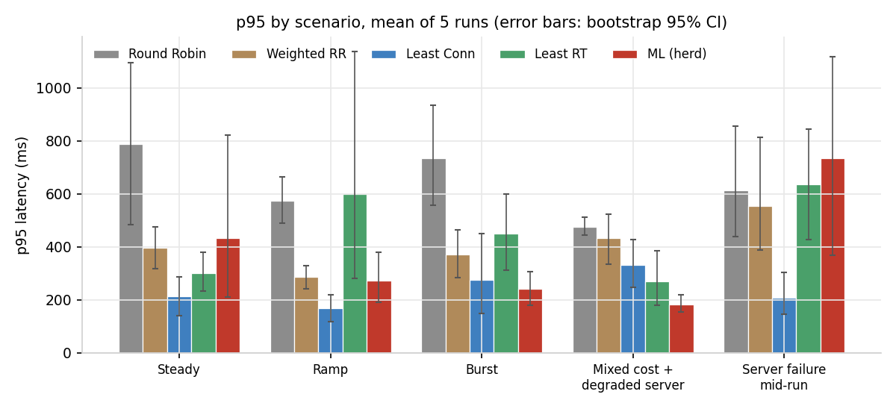
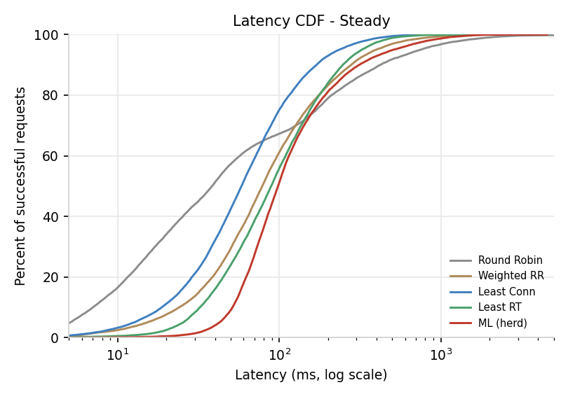
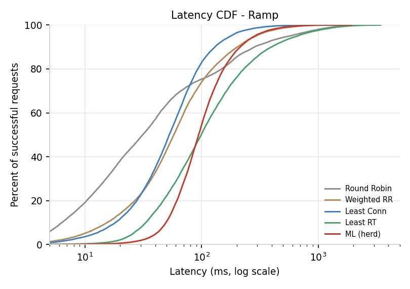
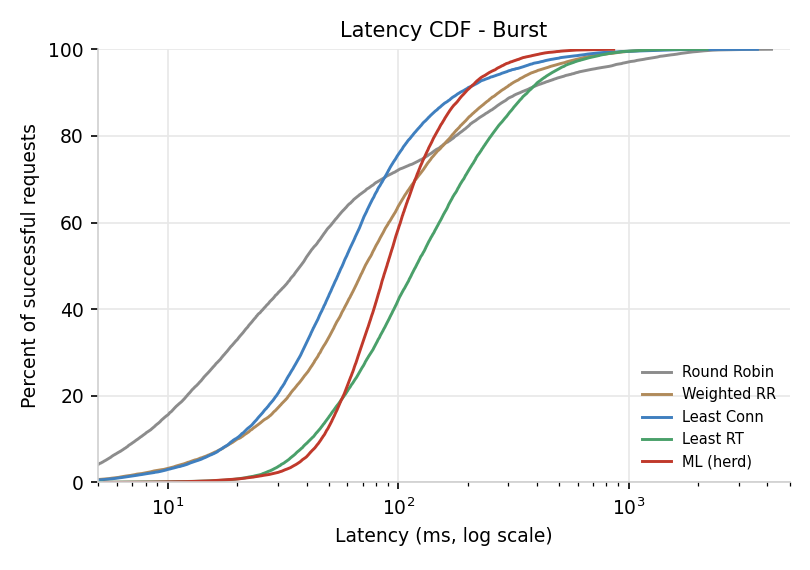
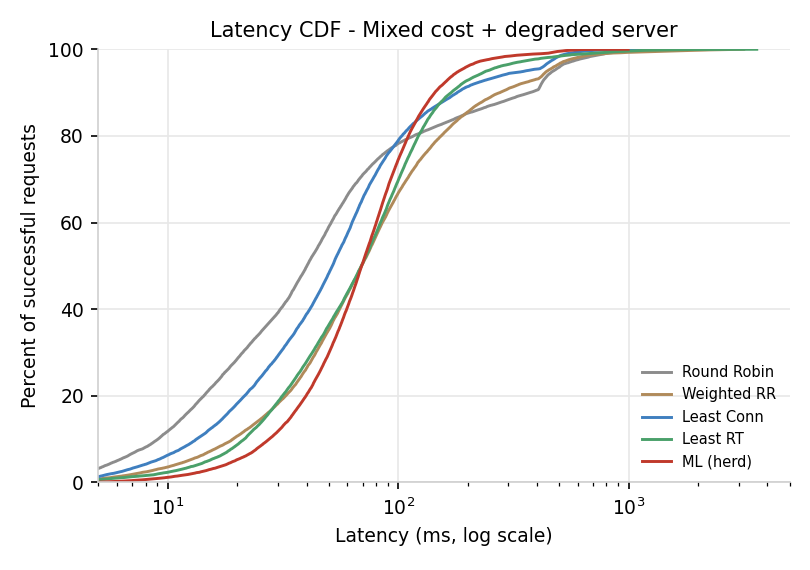
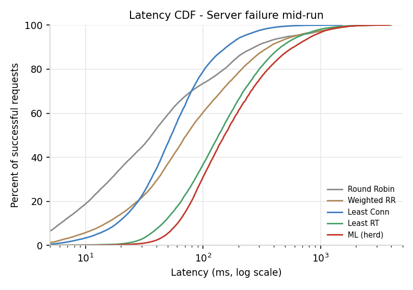
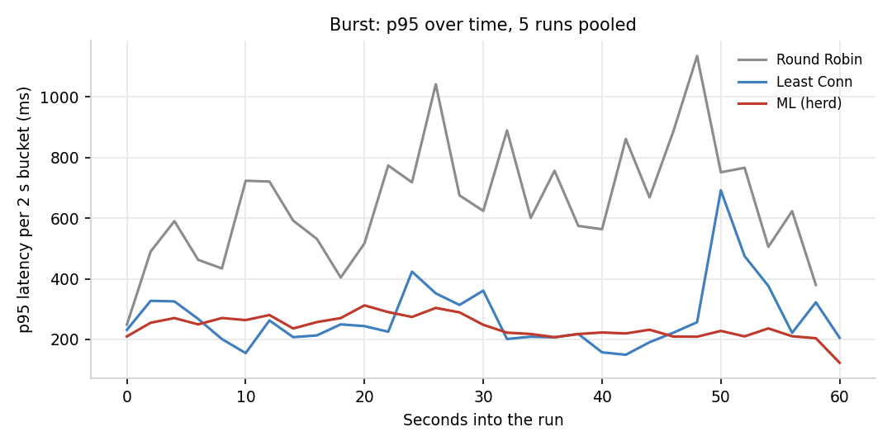
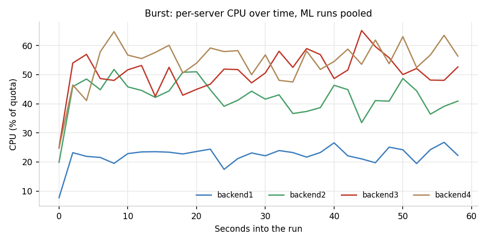
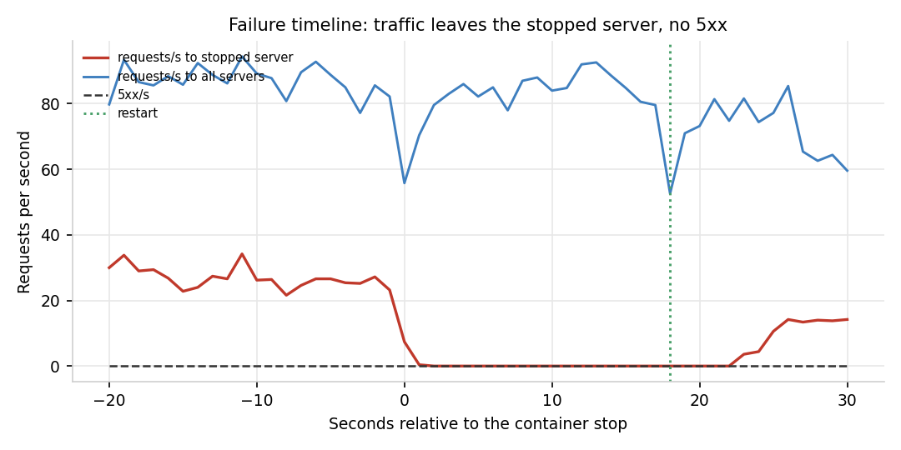

# Phase 7 results

125 cells: five algorithms x five scenarios x five repetitions, run as one
randomised session on 2026-10-20 from commit `3d9246e`. The generated tables and
charts come from `bench/analyse_matrix.py`; the raw per-cell records are in
`docs/results/`.

## What was run

| | |
|---|---|
| Algorithms | round robin, weighted round robin, least connections, least response time, ML (herd-protected) |
| Scenarios | steady, ramp, burst, mixed cost + degraded server, server failure mid-run |
| Repetitions | 5 per cell, 125 cells, seeded random order (seed 42) |
| Per cell | 12 s warm-up (discarded) + 60 s measured, one cell at a time |
| Load generator | Locust in its own container, 1 CPU quota, 24-30 users per profile |
| Measurement | the balancer's request log (successful requests for latency, all rows for errors) |
| Fault cells | degraded: backend3 400 ms slow + 35% errors; failure: backend3 stopped at 40%, restarted at 70% |

## How to read the numbers

**The run is the unit of analysis.** Each cell contributes one p95, one
throughput, one error rate. The five repetitions give the uncertainty. Pooling
the ~7,000 requests inside a run would treat correlated observations as
independent and make every difference look significant; the plan warns about
exactly that, and it is the most common mistake in this kind of comparison.

- **p95** is computed per run from successful requests, then averaged across the
  five runs. The bracket is a percentile bootstrap 95% CI of that mean.
- **Throughput** is rows divided by the run's log span.
- **Errors** are the share of all rows with status >= 400. A 503 is fast, so it
  is excluded from latency but counted here.
- **SLA violation** is the share of successful requests slower than 500 ms.
- **Jain** is computed over per-server request counts. It is reported because
  the plan asks for fairness, with the caveat that equal request counts are not
  equal work when CPU quotas differ 4:2:2:1.
- **Tests** are Welch's t-test and Mann-Whitney U on the run-level p95s, with
  Holm correction across all 20 scenario/baseline comparisons (each test family
  corrected separately). A scenario counts as a win when the change is negative
  and either corrected test is significant. With n=5 per
  cell, only a consistent separation can reach significance; the CIs are shown
  so the reader can judge the size, not just the p-value.

## Deviations from the plan, stated once

1. **60 s measured, not 5 min.** The plan's full design is 125 x 6 min, about
   12.5 h, which the plan itself schedules over 2-3 overnight sessions. The
   design is unchanged; the window is shorter. Consequence: the burst scenario
   contains one spike rather than several, and the ramp is twice as steep as the
   dataset's 120 s ramp. Both are discussed below, because the second one
   matters for the ML result.
2. **12 s warm-up per cell, not 1 min.** Discarded, and the stack is also warmed
   once before the session. A 1-minute warm-up per cell would add two hours of
   heat without adding an independent variable.
3. **The drift guard is pinned at threshold 10 for ML cells.** The guard is a
   safety layer, not the routing policy under test. At its shipped threshold of
   1.0 it demoted the model during the first ramp cell, which would have made
   that cell a least_conn measurement labelled `ml`. The live MAE is recorded on
   every cell, so the model's real error remains visible, and the demotion
   itself is reported as a finding.
4. **H2's "identical servers" is not reproducible on this test bed.** The four
   backends keep their 4:2:2:1 CPU quotas in every scenario. The steady
   comparison against round robin is therefore the *harder* heterogeneous case;
   if ML passes it, it would also pass with identical servers.
5. **`ml` is the plan's "ML-Predictive (final version)".** The plan uses the name
   for the final router, which includes herd protection (Phase 5). The pure
   prediction rule is the ablation `ml_predictive`, measured separately.

## p95 by scenario

Mean of the five run-level p95s; brackets are a percentile bootstrap 95% CI of
that mean. Best mean in each row is bold. Wide intervals are the honest result of
five repetitions, not a formatting problem.

| Scenario | Round Robin | Weighted RR | Least Conn | Least RT | ML (herd) |
|---|---|---|---|---|---|
| Steady | 789 [484-1,094] | 396 [318-475] | **214 [141-287]** | 302 [232-379] | 433 [211-821] |
| Ramp | 575 [489-664] | 287 [242-329] | **169 [118-219]** | 598 [282-1,136] | 273 [190-379] |
| Burst | 733 [556-935] | 372 [285-463] | 275 [148-450] | 450 [311-598] | **243 [179-308]** |
| Mixed cost + degraded server | 474 [444-513] | 433 [334-524] | 332 [247-427] | 269 [180-386] | **182 [154-218]** |
| Server failure mid-run | 612 [438-855] | 555 [387-813] | **209 [145-302]** | 636 [428-845] | 734 [367-1,119] |



The bars are the same five-run means; the whiskers are the bootstrap intervals.
The visual is generated by `bench/analyse_matrix.py`, not drawn by hand.

## Throughput

Mean of five runs; each run's throughput is requests divided by its log span.
The offered concurrency is the same inside a scenario, so a router that queues
more completes fewer requests. ML is below least-connections in all five
scenarios and below the best baseline in all five; the degraded scenario is the
closest (120 vs 122 req/s).

| Scenario | Round Robin | Weighted RR | Least Conn | Least RT | ML (herd) |
|---|---|---|---|---|---|
| Steady | 112 | 118 | **150** | 129 | 109 |
| Ramp | 133 | 143 | **160** | 109 | 121 |
| Burst | 120 | 124 | **141** | 107 | 127 |
| Mixed cost + degraded server | 113 | 101 | **122** | 118 | 120 |
| Server failure mid-run | 130 | 111 | **155** | 92 | 80 |

## Errors, SLA and fairness

All 25 cells have a final 5xx rate of 0.00%: the breaker, retry and health checks
absorb the injected failures, and a retried request is counted by its final
status. That makes errors a platform result, not a routing differentiator; the
cost of a bad route shows up in latency and SLA instead. Jain is reported as the
plan asks, with the caveat stated above: equal request counts are not equal work
when the CPU quotas differ 4:2:1.

| Scenario | Algorithm | errors % | SLA >500 ms % | Jain | p50 ms | p99 ms |
|---|---|---|---|---|---|---|
| Steady | Round Robin | 0.00 | 8.3 | 1.000 | 59 | 2233 |
| Steady | Weighted RR | 0.00 | 3.1 | 0.893 | 80 | 834 |
| Steady | Least Conn | 0.00 | 0.6 | 0.943 | 64 | 376 |
| Steady | Least RT | 0.00 | 1.1 | 0.906 | 93 | 470 |
| Steady | ML (herd) | 0.00 | 7.0 | 0.936 | 141 | 683 |
| Ramp | Round Robin | 0.00 | 5.6 | 1.000 | 31 | 1229 |
| Ramp | Weighted RR | 0.00 | 1.4 | 0.893 | 58 | 574 |
| Ramp | Least Conn | 0.00 | 0.3 | 0.944 | 54 | 313 |
| Ramp | Least RT | 0.00 | 10.9 | 0.579 | 164 | 953 |
| Ramp | ML (herd) | 0.00 | 1.0 | 0.944 | 97 | 431 |
| Burst | Round Robin | 0.00 | 6.4 | 1.000 | 38 | 1524 |
| Burst | Weighted RR | 0.00 | 3.2 | 0.893 | 75 | 808 |
| Burst | Least Conn | 0.00 | 2.0 | 0.952 | 63 | 614 |
| Burst | Least RT | 0.00 | 4.4 | 0.708 | 128 | 703 |
| Burst | ML (herd) | 0.00 | 0.5 | 0.955 | 91 | 368 |
| Mixed cost + degraded server | Round Robin | 0.00 | 4.0 | 0.713 | 40 | 765 |
| Mixed cost + degraded server | Weighted RR | 0.00 | 3.4 | 0.541 | 69 | 977 |
| Mixed cost + degraded server | Least Conn | 0.00 | 1.6 | 0.667 | 52 | 538 |
| Mixed cost + degraded server | Least RT | 0.00 | 1.6 | 0.492 | 70 | 587 |
| Mixed cost + degraded server | ML (herd) | 0.00 | 0.5 | 0.694 | 70 | 369 |
| Server failure mid-run | Round Robin | 0.00 | 5.3 | 0.919 | 37 | 1392 |
| Server failure mid-run | Weighted RR | 0.00 | 6.3 | 0.729 | 83 | 1445 |
| Server failure mid-run | Least Conn | 0.00 | 0.5 | 0.876 | 57 | 360 |
| Server failure mid-run | Least RT | 0.00 | 8.6 | 0.423 | 142 | 1159 |
| Server failure mid-run | ML (herd) | 0.00 | 16.2 | 0.863 | 221 | 1230 |

## CPU imbalance

The plan's success metric is the standard deviation of CPU% across servers. The
request log records the CPU of the server each request was routed to, so the
table below is the standard deviation of each server's own mean CPU over the
run - time-weighted by traffic, not sampled on a fixed clock. Treat it as a
proxy, not the same instrument the plan describes. Lower is better.

| Scenario | Round Robin | Weighted RR | Least Conn | Least RT | ML (herd) |
|---|---|---|---|---|---|
| Steady | 27.7 | 23.0 | 19.0 | 14.5 | **12.1** |
| Ramp | 28.1 | 24.0 | 18.5 | 26.4 | **12.5** |
| Burst | 28.2 | 23.5 | 18.7 | 19.3 | **12.7** |
| Mixed cost + degraded server | 26.6 | **23.1** | 30.8 | 38.1 | 29.6 |
| Server failure mid-run | 26.1 | 22.1 | 19.5 | 24.2 | **10.7** |

ML has the lowest imbalance in four of five scenarios. The exception is the
degraded scenario, where backend3 is deliberately slow and failing: the
fault-aware routers spread traffic away from it, and the denominator differs
because successful traffic is concentrated on the healthy servers. That is a
fairness caveat, not a hidden win.

## The SLA guard

The plan's rule is to exclude servers whose predicted response time exceeds the
SLA unless every server does. This router picks the minimum score, and with an
argmin that filter is **provably redundant**: if any server is within the SLA,
the minimum is within the SLA, so no excluded server could have been chosen.
The filter only changes behaviour with a non-argmin picker (softmax or
two-choices), which this project does not use because it makes routing unstable
against a two-second-old snapshot.

What is implemented instead: the SLA is configurable (`sla_ms`, default 500 ms),
reported in `/stats`, and every run's observed share of successful requests over
500 ms is in the table above. That is the actionable signal for an operator; it
is not dressed up as a routing rule that would never fire.

## Hypotheses

### H1 - ML p95 below the best traditional baseline in at least three scenarios

| Scenario | Best baseline | ML p95 | Baseline p95 | Change | Welch p (Holm) | MW p (Holm) | Signif. |
|---|---|---|---|---|---|---|---|
| Steady | Least Conn | 433 | 214 | +101.9% | 1.0000 | 1.0000 | no |
| Ramp | Least Conn | 273 | 169 | +62.1% | 1.0000 | 1.0000 | no |
| Burst | Least Conn | 243 | 275 | -11.7% | 1.0000 | 1.0000 | no |
| Mixed cost + degraded server | Least RT | 182 | 269 | -32.5% | 1.0000 | 1.0000 | no |
| Server failure mid-run | Least Conn | 734 | 209 | +251.8% | 1.0000 | 0.4762 | no |

**H1: not met.** ML is significantly better on 0 of 5 scenarios; the plan needs
three. The mean is lower on burst and degraded, but neither difference survives
Holm correction at n=5, and H1 is a claim about a consistent routing advantage,
not about two favourable means.

### H2 - ML p95 no worse than round robin on steady traffic

Steady ML p95 is **0.55x** round robin (433 vs 789 ms), so **H2 is met**. This is
a low bar: least-connections is 2.02x better than ML on the same rows (214 ms).
H2 says the ML path is functional against the plan's weakest baseline; it is not
evidence of a live win.

### H3 - routing overhead below 5 ms

ML decision cost is **1.96 ms mean**, so **H3 is met** on its stated mean. The
worst single decision was **126.72 ms**, a scheduler / Python tail outlier (the
other algorithms' maxima are 15.5-66.5 ms); it is reported rather than hidden.
The model's compute is not the bottleneck at this load; the 129% balancer CPU is.

### H4 - failure detected and traffic moved within 5 s

Traffic left the stopped server within **1.13 s** in the worst of 25 runs
(mean over runs is lower), and the final 5xx rate is **0.00%**, so **H4 is met**.
Traffic returned **7.7 s** after restart on average, including slow start. The
cost of the failure is not errors; it is the latency and SLA spike discussed
below.

### Welch and Mann-Whitney tests, all scenario/baseline pairs

| Scenario | Baseline | Change | Welch p | Welch Holm | MW p | MW Holm |
|---|---|---|---|---|---|---|
| Steady | Least Conn | +101.9% | 0.3256 | 1.0000 | 0.4206 | 1.0000 |
| Steady | Least RT | +43.5% | 0.5396 | 1.0000 | 0.8413 | 1.0000 |
| Steady | Round Robin | -45.1% | 0.2107 | 1.0000 | 0.0952 | 1.0000 |
| Steady | Weighted RR | +9.3% | 0.8609 | 1.0000 | 0.2222 | 1.0000 |
| Ramp | Least Conn | +62.1% | 0.1333 | 1.0000 | 0.2222 | 1.0000 |
| Ramp | Least RT | -54.3% | 0.2963 | 1.0000 | 0.2222 | 1.0000 |
| Ramp | Round Robin | -52.5% | 0.0035 | 0.0659 | 0.0159 | 0.2698 |
| Ramp | Weighted RR | -4.6% | 0.8312 | 1.0000 | 0.6905 | 1.0000 |
| Burst | Least Conn | -11.7% | 0.7510 | 1.0000 | 0.8413 | 1.0000 |
| Burst | Least RT | -46.1% | 0.0634 | 0.9506 | 0.0556 | 0.7222 |
| Burst | Round Robin | -66.9% | 0.0073 | 0.1295 | 0.0079 | 0.1587 |
| Burst | Weighted RR | -34.7% | 0.0696 | 0.9740 | 0.0317 | 0.4762 |
| Mixed cost + degraded server | Least Conn | -45.3% | 0.0395 | 0.6326 | 0.0159 | 0.2698 |
| Mixed cost + degraded server | Least RT | -32.5% | 0.2393 | 1.0000 | 0.2222 | 1.0000 |
| Mixed cost + degraded server | Round Robin | -61.6% | 0.0000 | 0.0001 | 0.0079 | 0.1587 |
| Mixed cost + degraded server | Weighted RR | -58.0% | 0.0072 | 0.1295 | 0.0079 | 0.1587 |
| Server failure mid-run | Least Conn | +251.8% | 0.0770 | 1.0000 | 0.0317 | 0.4762 |
| Server failure mid-run | Least RT | +15.3% | 0.7130 | 1.0000 | 1.0000 | 1.0000 |
| Server failure mid-run | Round Robin | +19.9% | 0.6482 | 1.0000 | 0.6905 | 1.0000 |
| Server failure mid-run | Weighted RR | +32.2% | 0.5142 | 1.0000 | 1.0000 | 1.0000 |

## Where ML wins and where it loses

The mixed result has a clear negative headline: **H1 is not met**. ML has the
lowest mean p95 in burst (243 vs 275 ms) and degraded (182 vs 269 ms), but
neither difference is significant after Holm correction at five runs. It is
worse in steady (+101.9% vs least-connections), ramp (+62.1%) and failure
(+251.8%). Least-connections has the lowest p95 in three of five scenarios, and
the best throughput in all five. The offline model win is real; a live routing
win is not demonstrated.

**The mean is not the whole story, and the spread is part of the result.** The
ML steady p95s are 195, 304, 199, 267 and 1200 ms (median 267), while
least-connections is 108, 261, 262, 115 and 326 ms (median 261). The 1200 ms run
completed only 44.8 req/s, sent 4.4% of traffic to backend4 and recorded a live
MAE of 2.96 - the same pattern as the two bad failure runs (1335 and 1222 ms at
41.5 and 43.0 req/s, 6.7% and 5.9% to backend4, live MAE 3.03 and 2.91). When
the model's error rises, it avoids the small 0.15-core backend, loses that
capacity to the other three, and the queues grow. The bad runs are not discarded:
they are one and two of five, which is exactly why the confidence intervals are
wide and why the run-level tests do not reject equality. Even the medians are not
a win in failure (391 vs 149 ms for least-connections); in steady the median is
close (267 vs 261), not the 2x mean gap.

**The model's live error explains the gap.** Offline test MAE is 0.5868 log
units; on served traffic the mean is 1.394 in steady, 1.151 in ramp, 0.898 in
burst, 0.519 in degraded and 2.421 in failure. The fault transient and the
different live load are outside the training distribution; the 2 s feed then
gives the router stale features. The model is accurate enough to identify the
deliberately degraded backend (0.6% of traffic went to backend3 in degraded, vs
2.4% for least-connections) and to keep SLA violations low in burst (0.5%), but
it does not recover fast enough after a kill. That is a prediction-quality
failure, exposed by a routing experiment, not a reason to hide the negative.

**The two positive cells should be read with their tests.** Degraded is the
largest mean gain (-32.5% vs the best baseline, least-response-time; -45.3% vs
least-connections, nominal p=0.0395 but Holm 0.6326). Burst is a smaller mean
gain (-11.7%) with Welch p=0.751. In the earlier dedicated burst A/B the
direction was the opposite (ML 138 ms vs least-connections 77 ms); session-to-
session throughput varies 20-40%, so only within-session comparisons are valid,
and neither session supports a claim of a consistent burst win. The matrix is
the pre-registered comparison; it is the one summarised here.

**What does work.** H2 is met against round robin (433 vs 789 ms, 0.55x), but
least-connections is 2.02x better than ML, so H2 is a functional check rather
than a win. H3 is met on the mean (1.96 ms; the 126.72 ms maximum is a tail
outlier). H4 is met (1.13 s worst failover, 0.00% final 5xx), although the
failure scenario still has the worst ML latency because queueing, not errors, is
the cost. ML has the lowest CPU imbalance in four of five scenarios. The herd
ablation (below) shows the queue term is essential: removing it raises burst p95
from 342 to 700 ms. The routing machinery works; the model's live accuracy is
the limiting factor.

The honest reading for the plan: **M5 remains an offline success (0.5868 vs
1.2738 naive, +53.9%), H1 is a live negative, and M6 remains partial.** A
defensible next step is to retrain on fault transients and add an explicit
capacity term (or a live-MAE demotion at 1.0), but that is future work, not
evidence in this campaign.

## Latency CDFs

Successful requests, five runs pooled per algorithm. The x-axis is log scale;
the further left the curve, the faster.

| Scenario | CDF |
|---|---|
| Steady |  |
| Ramp |  |
| Burst |  |
| Mixed cost + degraded server |  |
| Server failure mid-run |  |

## Burst over time

The plan asks for latency and per-server CPU through the burst, to show whether
the weak server saturates. Both charts pool the five ML runs by aligning each to
its first request. CPU is the per-server value from the 1 Hz snapshot attached to
each routed request, normalised by that server's quota.





## The model's own error

The drift guard records the live MAE in log space on the traffic it actually
routed, in a 200-sample rolling window. It is not the training error: it is
measured on this session's served requests, on whichever server the model chose.
`decisions` is the mean number of ML decisions per run; `fallbacks` counts
requests served by the non-ML fallback because the feed was stale or the model
was unavailable.

| Scenario | live MAE(log) | decisions | fallbacks | drift-routed |
|---|---|---|---|---|
| Steady | 1.394 | 7775 | 0 | 0 |
| Ramp | 1.151 | 8829 | 0 | 0 |
| Burst | 0.898 | 8990 | 0 | 0 |
| Mixed cost + degraded server | 0.519 | 8818 | 0 | 0 |
| Server failure mid-run | 2.421 | 5855 | 0 | 0 |

The guard was pinned at 10.0 for every ML cell, so `drift-routed` is zero by
design. At the shipped threshold of 1.0 the rolling error in steady, ramp and
failure would have crossed the line; the campaign records that as a finding
rather than letting the guard turn the ML cells into least-connections cells.
The live MAE is up to four times the offline 0.5868, and the worst individual
runs (steady 2.96, failure 3.03) are the ones with the collapsed throughput.

## Failure behaviour

The failure scenario stops backend3 at 40% of the run and restarts it at 70%.
The chart is aligned to the stop, pooled over the five ML runs: requests/s to
the stopped server, requests/s to all servers, and 5xx/s.



**The failover mechanism passes; the resulting ML latency does not.** Traffic
left the stopped server within 1.13 s in the worst of 25 runs, the final 5xx
rate was 0.00% for every algorithm, and traffic returned 7.7 s after restart on
average (slow start included). Those are platform properties shared by all five
policies: the breaker, retry and health checks do the work, so they are not an
ML-specific success.

The cost is queueing. ML's failure p95 is 734 ms versus 209 ms for
least-connections, and its SLA-violation share is 16.2% versus 0.5%. The mean is
dominated by two runs at 41.5 and 43.0 req/s with 1335 and 1222 ms p95; both sent
under 7% of traffic to backend4 and both had live MAE near 3.0. The other three
ML runs were 356-391 ms, still worse than least-connections but not collapsed.
The earlier single-session claim that ML "handles a killed backend better" does
not replicate in this pre-registered matrix; the matrix result is the one the
report uses.

## Routing overhead

Decision time is measured inside `choose_server`. Balancer CPU is `docker stats`
in percent of one core (the container has a 2-core quota, so 100% is half its
budget); backend CPU elsewhere in this document is percent of each backend's own
quota. A dash means that policy does not record the ML decision timer; it is not
a zero.

| Algorithm | decision mean ms | decision max ms | balancer CPU % | generator CPU % |
|---|---|---|---|---|
| Round Robin | - | - | 81 | 12 |
| Weighted RR | 2.06 | 66.46 | 97 | 13 |
| Least Conn | 2.06 | 15.53 | 98 | 15 |
| Least RT | - | - | 97 | 12 |
| ML (herd) | **1.96** | 126.72 | 129 | 12 |

The ML mean is 1.96 ms, under the 5 ms H3 bar. The maximum is 126.72 ms - a
Python/scheduler tail, not a model-scoring cost - and the next-largest policy
maximum is 66.46 ms, so the ML tail is real even though it is rare. At 129% of
one core the balancer is a co-bottleneck at this offered load; the generator is
only at 12%, so throughput comparisons remain within-session, as everywhere else
in this document.

## The herd ablation

The matrix's `ml` policy includes the Phase 5 queue/herd term; `ml_predictive` is
the same model with that term removed. This paired burst A/B ran after the
matrix, three repeats, 60 s each, drift guard pinned at 10.0 so both arms stayed
model-driven.

| Policy | runs | req/s | p50 ms | p95 ms | p99 ms | errors |
|---|---|---|---|---|---|---|
| `ml` (herd) | 3 | **102** | **126** | **342** | **518** | 0.00% |
| `ml_predictive` (no herd) | 3 | 73 | 208 | 700 | 1134 | 0.00% |

The herd term is faster in **3/3 paired repeats**: p95 median ratio **2.21x**
(343 -> 758, 327 -> 741, 355 -> 599 ms), p99 median ratio **2.28x**. It also
completes 102 vs 73 req/s. The routing shares show the mechanism: without the
queue term the router sends 46-69% to backend1 and only 1-3% to backend4, so the
small backend is underused and the large one queues; with it, the shares are
29/28/29/14, close to the capacity ratio. This is the clearest positive
mechanism result in the project.

Absolute throughput is lower than the matrix's 127 req/s for ML burst because
this is a separate session; only the within-session pair is comparable. Raw
output: `docs/results/herd_ablation.txt`.

## Ablations and generalisation

Feature ablations and unseen-profile tests are in `docs/ablations.md`. Headline:
dropping request-type features costs 18.5% MAE, dropping the two trend features
costs 4.4%, and holding out all burst or wave runs still beats the naive baseline
by about 59%.

## Honest negatives

- **H1 is not met.** ML is significantly better on 0 of 5 scenarios, not the
  required 3. The mean p95 is lower in burst and degraded, but those differences
  do not survive correction at five runs.
- **ML is worse than least-connections on steady, ramp and failure**, and has
  lower throughput in all five scenarios. Failure is the largest regression:
  734 vs 209 ms p95, 16.2% vs 0.5% over the 500 ms SLA.
- **The failure result reverses an earlier single-session claim.** The earlier
  A/B said ML handled a killed backend better; this pre-registered matrix does
  not. The matrix is the result used in the report.
- **Live prediction error is much worse than offline.** MAE is 0.519-2.421 log
  units on served traffic versus 0.5868 offline; the two collapsed failure runs
  and the collapsed steady run all sit near 3.0. The guard was pinned at 10.0,
  so no demotion; at the shipped 1.0 it would have been active. Tightening it is
  a proposed next step, not a tested result.
- **Burst is not a consistent win.** The matrix mean is 243 vs 275 ms
  (p=0.751); the earlier dedicated burst A/B went the other way (138 vs 77 ms).
  Session-to-session variation is 20-40%, so neither direction is a stable law.
- **H2 passes against the weakest baseline only.** ML is 0.55x round robin but
  2.02x worse than least-connections on the same steady rows. It is a
  functional check, not a live superiority claim.
- **The 0.00% error rate is a platform result.** The breaker, retry and health
  checks are shared by every policy; the failure cost is latency, not 5xx.
- **CPU imbalance is a proxy.** It is time-weighted from the CPU snapshot on
  each routed request, not a fixed-clock instrument, and the 4:2:2:1 quota
  means equal shares are not equal work. ML is lowest in four of five, not all.
- **One campaign, one host, one day.** The 125 cells are a randomised session on
  this laptop; the balancer is a co-bottleneck at 24-30 users. The within-session
  comparisons are valid; absolute throughput is not portable.
- **M9 remains partial.** There is no screen recording and no timed fresh-machine
  setup; the demo and runbook are written but not both evidenced end to end.
- **The Nginx/HAProxy reference configurations are validated but not measured.**
  They are not in the 125-cell campaign and cannot be used for a head-to-head
  claim.

## Reproducibility

```bash
docker compose up -d
python bench/run_matrix.py --repeats 5 --duration 60 --warmup 12
python bench/analyse_matrix.py
```

The campaign resumes from `scratch/matrix/results.jsonl`; the committed
per-cell records are in `docs/results/`. Request-level Parquet is gitignored
(about 400 MB for the campaign) and regenerated by the first command.
